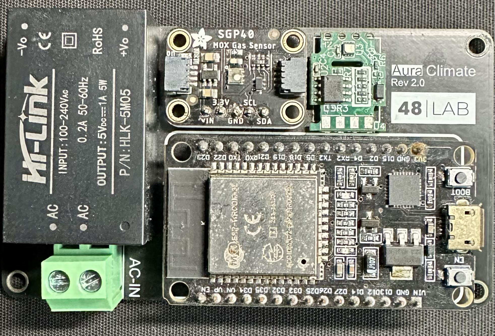
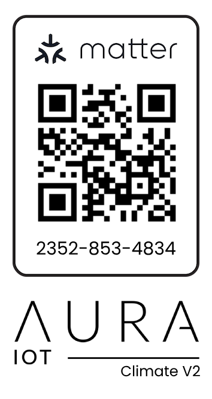

<p align="center">
  
</p>

# Aura Climate

<p align="center">
  <a href="https://github.com/jrsarath/Aura-Climate/releases"></a>
  <a href="LICENSE"></a>
  <a href="https://github.com/espressif/esp-idf"></a>
  <a href="https://github.com/espressif/esp-matter"></a>
  <a href="https://csa-iot.org/all-solutions/matter/"></a>
  <a href="https://365.altium.com/files/E2252F43-3197-4BE0-AAA4-C608606C2910"></a>
  <a href="#"></a>
</p>

---

## Table of Contents

- [Aura Climate](#aura-climate)
  - [Table of Contents](#table-of-contents)
  - [Overview](#overview)
  - [Key Features](#key-features)
  - [Hardware Architecture \& Components](#hardware-architecture--components)
    - [Hardware Used](#hardware-used)
    - [GPIO Pinout Mapping](#gpio-pinout-mapping)
    - [Hardware \& PCB Design](#hardware--pcb-design)
  - [E-Paper Display Interface](#e-paper-display-interface)
  - [Matter Data Model](#matter-data-model)
  - [Getting Started](#getting-started)
    - [Prerequisites](#prerequisites)
    - [1. Clone Repository](#1-clone-repository)
    - [2. Set Target MCU](#2-set-target-mcu)
    - [3. Configure Project](#3-configure-project)
    - [4. Build Firmware](#4-build-firmware)
  - [Custom Setup Codes \& Manufacturing Data](#custom-setup-codes--manufacturing-data)
    - [Why Custom Setup Codes?](#why-custom-setup-codes)
    - [Pre-Configured Setup Credentials](#pre-configured-setup-credentials)
    - [Generating New Custom Setup Codes (`mfg_tool.py`)](#generating-new-custom-setup-codes-mfg_toolpy)
  - [Flashing Guide](#flashing-guide)
    - [1. Find Your Serial Port](#1-find-your-serial-port)
    - [2. Flash Firmware \& Custom Partition](#2-flash-firmware--custom-partition)
    - [3. Erasing Flash (Factory Reset)](#3-erasing-flash-factory-reset)
  - [Matter Commissioning \& Pairing](#matter-commissioning--pairing)
  - [Interactive Console (CHIP Shell)](#interactive-console-chip-shell)
  - [Over-The-Air (OTA) Updates](#over-the-air-ota-updates)
  - [Project Structure](#project-structure)
  - [Related Projects](#related-projects)
  - [Credits \& Acknowledgments](#credits--acknowledgments)
  - [License](#license)

---

## Overview

**Aura Climate** is an open-source, production-grade ambient indoor climate monitor built on top of the **Espressif ESP-Matter SDK** and **ESP-IDF**. It integrates seamlessly with major smart home ecosystems—including **Apple Home**, **Google Home**, **Home Assistant**, and **Amazon Alexa**—using the standard Matter protocol over Wi-Fi / Thread.

The device continuously tracks environmental temperature, relative humidity, and comprehensive indoor air quality metrics (AQI, TVOC, eCO2). Measured data is presented locally on a high-contrast 3.7" E-Paper display and synchronized in real time with your Matter fabric.

```
┌─────────────────┐       ┌─────────────────┐       ┌─────────────────┐
│ Sensirion SHT40 │       │ ScioSense ENS160│       │   Good Display  │
│  (Temp / Hum)   │       │   (AQI / Gas)   │       │ 3.7" E-Paper SPI│
└────────┬────────┘       └────────┬────────┘       └────────┬────────┘
         │                         │                         │
         └─────────► I2C Bus ◄─────┘                         │ SPI
                           │                                 │
                 ┌─────────▼─────────────────────────────────▼────────┐
                 │             ESP32-C6 / ESP32 MCU                   │
                 │   - ESP-Matter Core (Air Quality, Temp, Humidity)  │
                 │   - Non-blocking FreeRTOS Display Task             │
                 │   - Factory Partition DAC & Custom Setup Codes     │
                 │   - Background OTA Manager & Health Monitor        │
                 └─────────────────────────┬──────────────────────────┘
                                           │
                         Wi-Fi / Thread (Matter Protocol)
                                           │
                 ┌─────────────────────────▼──────────────────────────┐
                 │  Apple Home | Google Home | Home Assistant | Alexa │
                 └────────────────────────────────────────────────────┘
```

---

## Key Features

- **Standard Matter Support**: Native clusters for `TemperatureMeasurement`, `RelativeHumidityMeasurement`, and `AirQuality` (with UBA AQI classification, TVOC, and eCO2).
- **Custom Setup Codes & Factory Data**: Factory partition provisioning (`fctry`/`nvs`) containing custom Vendor ID (VID), Product ID (PID), custom discriminator, passcode, and Device Attestation Certificates (DACs).
- **Ultra-Clear E-Paper Dashboard**: 3.7" monochrome e-ink screen (240x416) using a custom dual-column layout driven by `CalEPD` + `Adafruit-GFX` in a non-blocking FreeRTOS task.
- **Smart LED Feedback**: Built-in addressable RGB LED (WS2812) dynamically pulses during Matter commissioning sessions.
- **Resilient OTA Updates**: Built-in `OTAManager` supporting automated polling, dual-bank A/B partition swapping, and rollback protection on failed boot.
- **Low Power & Mains Capable**: Onboard AC-DC Hi-Link power supply module for direct wall outlet deployment alongside standard USB-C debugging.
- **Interactive CHIP Shell**: Real-time UART console for Wi-Fi management, commissioning control, and hardware diagnostics.

---

## Hardware Architecture & Components

### Hardware Used

| Component | Part / Model | Interface | Description |
|:----------|:-------------|:----------|:------------|
| **Microcontroller** | ESP32-C6 / ESP32 DevKit | SoC | 32-bit RISC-V / Xtensa MCU, 8MB SPI Flash, Wi-Fi 6 (2.4GHz), 802.15.4 (Thread), and BLE 5. |
| **Temp & Humidity Sensor** | Sensirion SHT40 | I2C | High-precision sensor (±0.2°C accuracy, ±1.8% RH). Factory calibrated. |
| **Air Quality Sensor** | ScioSense / Adafruit ENS160 | I2C (`0x52`) | Multi-gas MOX sensor reporting UBA AQI (1–5), TVOC (ppb), and equivalent CO₂ (eCO2 ppm). |
| **E-Paper Display** | Good Display GDEQ037T31 | SPI | 3.7-inch monochrome e-ink display (240x416 resolution, 4 grey levels, fast refresh mode). |
| **Commissioning Indicator** | Addressable RGB LED (WS2812) | Single-wire RMT | High-visibility status indicator for commissioning and system diagnostics. |
| **Push Button** | Momentary Tactile Switch | GPIO | Used for manual input and hardware factory reset (5-second long press). |
| **AC-DC Converter** | Hi-Link HLK-PM01 | Mains / DC | Converts 100–240V AC to 5V DC for compact, standalone indoor wall installation. |
| **Custom PCB** | 2-Layer Custom Board | Hardware | Custom board layout integrating sensors, display header, power, and ESP32 DevKit. |

### GPIO Pinout Mapping

All pins are fully configurable via `idf.py menuconfig`. The default reference design uses the following pinout:

| Peripheral | Signal | ESP32-C6 Pin | ESP32 Pin | Config Option |
|:-----------|:-------|:-------------|:----------|:--------------|
| **I2C Bus** | I2C SDA | `GPIO 6` | `GPIO 21` | `CONFIG_GPIO_I2C_MASTER_SDA` |
| **I2C Bus** | I2C SCL | `GPIO 7` | `GPIO 22` | `CONFIG_GPIO_I2C_MASTER_SCL` |
| **RGB Indicator** | WS2812 Data | `GPIO 8` | `GPIO 8` | `CONFIG_GPIO_INDICATOR_LED` |
| **Push Button** | Reset / Action | `GPIO 9` (BOOT) | `GPIO 0` | DevKit BSP button |
| **E-Paper Display**| SPI MOSI (DIN) | `GPIO 19` | `GPIO 23` | `CONFIG_EINK_SPI_MOSI` |
| **E-Paper Display**| SPI CLK | `GPIO 18` | `GPIO 18` | `CONFIG_EINK_SPI_CLK` |
| **E-Paper Display**| Chip Select (CS) | `GPIO 10` | `GPIO 4` | `CONFIG_EINK_SPI_CS` |
| **E-Paper Display**| Data / Command (DC)| `GPIO 11` | `GPIO 5` | `CONFIG_EINK_DC` |
| **E-Paper Display**| Hardware Reset (RST)| `GPIO 2` | `GPIO 6` | `CONFIG_EINK_RST` |
| **E-Paper Display**| Busy Status | `GPIO 3` | `GPIO 7` | `CONFIG_EINK_BUSY` |

### Hardware & PCB Design

- **Altium 365 Schematic & Layout**: [Aura Climate PCB on Altium 365](https://365.altium.com/files/E2252F43-3197-4BE0-AAA4-C608606C2910)
- **Demo Device Photo**:

<p align="center">
  
</p>

---

## E-Paper Display Interface

The display uses the **Good Display GDEQ037T31** driven by `CalEPD` and `Adafruit-GFX` with a dedicated Orbitron font. Updates are queued and processed asynchronously via FreeRTOS (`epaper_manager.cpp`) to prevent blocking Matter network operations.

- **Dual-Column Layout (Landscape - Rotation 3)**:
  - **Left Column**: Real-time Temperature (°C) and Relative Humidity (%).
  - **Right Column**: Air Quality status (Good, Fair, Moderate, Poor, Hazardous), eCO2 (ppm), and TVOC (ppb).
  - **Header**: Live refresh time badge (e.g. `now`, `2m ago`).
  - **Footer**: Device identifier (`Aura Climate`) and firmware version string.
- **Refresh Interval**: Configured by default to 60 seconds (`CONFIG_EPD_UPDATE_INTERVAL`).

---

## Matter Data Model

Aura Climate exposes a unified Matter node with three specialized endpoints:

| Endpoint ID | Cluster Name | Cluster ID | Attribute | Description |
|:------------|:-------------|:-----------|:----------|:------------|
| **Endpoint 1** | `TemperatureMeasurement` | `0x0402` | `MeasuredValue` (`0x0000`) | Ambient temperature in 0.01 °C units. |
| **Endpoint 2** | `RelativeHumidityMeasurement` | `0x0405` | `MeasuredValue` (`0x0000`) | Relative humidity in 0.01 % units. |
| **Endpoint 3** | `AirQuality` | `0x005B` | `AirQuality` (`0x0000`) | UBA air quality index: `Good`, `Fair`, `Moderate`, `Poor`, `ExtremelyPoor`. |

---

## Getting Started

### Prerequisites

Ensure you have the following software installed:

1. **ESP-IDF (v5.2+ recommended)**:
   ```bash
   # Follow Espressif's standard setup guide
   git clone -b v5.2.2 --recursive https://github.com/espressif/esp-idf.git ~/esp/esp-idf
   cd ~/esp/esp-idf && ./install.sh && . ./export.sh
   ```
2. **ESP-Matter SDK**:
   ```bash
   git clone --depth 1 https://github.com/espressif/esp-matter.git ~/esp/esp-matter
   cd ~/esp/esp-matter && git submodule update --init --depth 1
   cd ~/esp/esp-matter && ./install.sh && . ./export.sh
   ```
3. **Serial Drivers**: Ensure your machine recognizes USB UART devices (Silicon Labs CP210x, CH34x, or Espressif USB Serial/JTAG).

---

### 1. Clone Repository

Clone the project recursively to pull all git submodules:

```bash
git clone --recursive https://github.com/jrsarath/Aura-Climate.git
cd Aura-Climate
```

If you previously cloned without `--recursive`:
```bash
git submodule update --init --recursive
```

### 2. Set Target MCU

Set the build target according to your hardware (default is `esp32c6`):

```bash
# For ESP32-C6:
idf.py set-target esp32c6

# For classic ESP32:
idf.py set-target esp32
```

### 3. Configure Project

Open the interactive configuration menu to adjust GPIOs, display intervals, or networking:

```bash
idf.py menuconfig
```

Key configuration locations:
- `Sensor Configuration` ➔ Set I2C SDA, SCL, and ARGB Indicator LED pins.
- `E-Paper Display Configuration` ➔ Set the refresh interval (default 60s).
- `Display Configuration` ➔ Set SPI pins (`MOSI`, `CLK`, `CS`, `DC`, `RST`, `BUSY`).

### 4. Build Firmware

Compile the application and all managed dependencies:

```bash
idf.py build
```

---

## Custom Setup Codes & Manufacturing Data

### Why Custom Setup Codes?

Standard Matter test devices use generic development credentials:
- **Default Test Passcode:** `20202021`
- **Default Test Discriminator:** `3840`

When running multiple Matter devices or producing customized hardware, using default codes causes commissioning collisions in smart home ecosystems.

**Aura Climate is configured to use custom manufacturing data and custom setup codes** via:
- `CONFIG_ENABLE_ESP32_FACTORY_DATA_PROVIDER=y`
- `CONFIG_ENABLE_ESP32_DEVICE_INSTANCE_INFO_PROVIDER=y`
- Custom partition table `partitions.csv` with a dedicated factory data partition (`fctry`/`nvs`).

### Pre-Configured Setup Credentials

The repository includes pre-generated factory credentials located under `out/48_1000/`:

| Parameter | Value | Details |
|:----------|:------|:--------|
| **Vendor Name** | `48 Lab` | Custom vendor |
| **Vendor ID (VID)** | `0x0048` (Decimal `72`) | Registered / Test VID |
| **Product Name** | `Aura Climate` | Device name |
| **Product ID (PID)** | `0x1000` (Decimal `4096`) | Model identifier |
| **Discriminator** | `2598` | 12-bit custom pairing discriminator |
| **Passcode (PIN)** | `57067989` | 8-digit custom commissioning code |
| **Manual Pairing Code** | `2352-853-4834` | 11-digit manual pairing code |
| **QR Code Payload** | `MT:6F000UDN16O-DO4V710` | Matter commissioning payload |

<p align="center">
  <br />
  <em>Onboarding QR Code (Discriminator: 2598, Passcode: 57067989)</em>
</p>

---

### Generating New Custom Setup Codes (`mfg_tool.py`)

If you want to generate your own unique setup codes, discriminators, and serial numbers, use the **ESP-Matter Manufacturing Tool** (`mfg_tool.py`):

```bash
# Ensure ESP-Matter environment is sourced
. $ESP_MATTER_PATH/export.sh

# Run mfg_tool to create a new partition
python $ESP_MATTER_PATH/tools/mfg_tool/mfg_tool.py \
  --vendor-id 0x0048 \
  --vendor-name "48 Lab" \
  --product-id 0x1000 \
  --product-name "Aura Climate" \
  --hw-ver 2 \
  --hw-ver-str "v2.0" \
  --serial-num "CL-0002" \
  --discriminator 2598 \
  --passcode 57067989 \
  --target esp32c6 \
  -out custom_out
```

This command generates:
1. `custom_out/<uuid>-partition.bin`: The binary partition image containing DAC keys, certificates, discriminator, and verifier.
2. `custom_out/<uuid>-qrcode.png`: The printable onboarding QR code.
3. `custom_out/<uuid>-onb_codes.csv`: Manual pairing code and text payload.

---

## Flashing Guide

### 1. Find Your Serial Port

Connect your ESP32 board to your computer via USB:
- **macOS**: `/dev/cu.usbserial-*` or `/dev/cu.usbmodem*`
- **Linux**: `/dev/ttyUSB0` or `/dev/ttyACM0`
- **Windows**: `COM3`, `COM4`, etc.

### 2. Flash Firmware & Custom Partition

Flash the main application binary:

```bash
idf.py -p <PORT> -b 921600 flash monitor
```

> [!IMPORTANT]
> Because this project uses custom factory credentials, you must flash the manufacturing partition binary (`partition.bin`) to your board.
>
> In `partitions.csv`, the factory partition is located at offset `0x10000` (`nvs`) or `0x620000` (`fctry`).

Flash the pre-built factory partition binary:

```bash
esptool.py -p <PORT> -b 921600 write_flash 0x10000 out/48_1000/a44174d7-ef0e-4a14-b33a-93af6c44fa71/a44174d7-ef0e-4a14-b33a-93af6c44fa71-partition.bin
```

Alternatively, you can flash both firmware and the factory partition in a single step:

```bash
idf.py -p <PORT> flash && esptool.py -p <PORT> write_flash 0x10000 out/48_1000/a44174d7-ef0e-4a14-b33a-93af6c44fa71/a44174d7-ef0e-4a14-b33a-93af6c44fa71-partition.bin
```

### 3. Erasing Flash (Factory Reset)

To clear all stored Wi-Fi credentials and previous fabric pairings:

```bash
idf.py -p <PORT> erase-flash
```

> [!WARNING]
> Erasing flash deletes the factory partition. Always re-flash the custom partition binary (`write_flash 0x10000 ...`) after performing `erase-flash`.

---

## Matter Commissioning & Pairing

Once flashed and booted:

1. **Commissioning Window**:
   - The onboard RGB LED pulses in a smooth breathing animation indicating that the Matter Bluetooth LE commissioning window is active.
2. **Open Your Matter App**:
   - **Apple Home**: Open Home app ➔ Tap `+` ➔ *Add Accessory* ➔ Scan the QR Code (`assets/pairing-code.png`) or enter code `2352-853-4834`.
   - **Google Home**: Open Google Home ➔ Tap `+` ➔ *Set up device* ➔ *New device* ➔ *Matter device*.
   - **Home Assistant**: Navigate to *Settings* ➔ *Devices & Services* ➔ *Add Integration* ➔ *Matter* ➔ Scan QR Code.
3. **Commissioning Complete**:
   - The RGB LED turns off.
   - Temperature, Humidity, and Air Quality sensors will appear in your dashboard.
4. **Hardware Reset**:
   - Press and hold the physical button for **5 seconds** to trigger a device factory reset and re-open the commissioning window.

---

## Interactive Console (CHIP Shell)

The firmware includes the interactive `chip-shell` console over UART at `115200` baud. Connect with `idf.py monitor` to issue diagnostics and management commands:

```bash
# Print Matter diagnostics
matter device diagnostics

# Trigger a factory reset
matter device factoryreset

# Check Wi-Fi connection status
matter wifi status

# Open commissioning window manually
matter session open
```

---

## Over-The-Air (OTA) Updates

Aura Climate includes automated background OTA update handling managed by `OTAManager` (`ota_manager.cpp`):

- **Update Polling**: Periodically checks for updates every hour (`OTA_CHECK_INTERVAL_MS = 3600000`).
- **Endpoint**: Configured in `config.hpp` (`https://ota.48studios.dev/aura/climate/2`).
- **Dual OTA Partitions**: Uses `ota_0` and `ota_1` (3MB each in `partitions.csv`).
- **Rollback Protection**: Automatically verifies application boot and reverts to the previous working slot if an error occurs.

---

## Project Structure

```
Aura-Climate/
├── assets/                       # Graphics, diagrams, demo pictures, and QR codes
│   ├── aura.svg                  # Project banner
│   ├── device.jpg                # Hardware prototype photograph
│   └── pairing-code.png          # Matter onboarding QR code
├── components/                   # Embedded display drivers & graphics libraries
│   ├── Adafruit-GFX/             # Adafruit GFX library adapted for ESP-IDF
│   └── CalEPD/                   # E-Paper display driver library
├── main/                         # Core firmware source code
│   ├── include/                  # Header files (config, drivers, fonts, variables)
│   │   ├── Orbitron_Medium*.h    # Custom Orbitron typography for E-Paper
│   │   ├── config.hpp            # Central pin, sensor, and OTA definitions
│   │   ├── driver.hpp            # GPIO, button, and RGB LED drivers
│   │   ├── epaper_manager.hpp    # E-paper display task headers
│   │   ├── ota_manager.hpp       # OTA update manager header
│   │   └── sensors.hpp           # Sensor abstraction and I2C management
│   ├── CMakeLists.txt            # Main component build script
│   ├── Kconfig.projbuild         # Project Kconfig definitions
│   ├── driver.cpp                # LED and button driver implementations
│   ├── epaper_manager.cpp        # E-paper UI rendering & queue management
│   ├── idf_component.yml         # IDF component manager dependencies
│   ├── main.cpp                  # Application entry point & Matter node init
│   ├── ota_manager.cpp           # Secure OTA update task implementation
│   ├── sensors.cpp               # SHT40 and ENS160 I2C drivers
│   └── utils.cpp                 # Utility and helper functions
├── out/                          # Generated manufacturing data and credentials
│   └── 48_1000/                  # VID 0x0048, PID 0x1000 manufacturing files
│       ├── a44174d7-.../         # Factory partition binary & onboarding codes
│       └── summary-*.csv         # Provisioning credentials log
├── CMakeLists.txt                # Top-level CMake project file
├── partitions.csv                # Custom partition table layout
├── sdkconfig.defaults            # Project default configuration options
└── README.md                     # Documentation
```

---

## Related Projects

- [Aura Control](https://github.com/jrsarath/aura-control) — Matter-enabled smart relay and multi-gang wall switch controller.
- [Aura Management](https://github.com/jrsarath/aura-ota) — Centralized OTA firmware distribution service and fleet management platform for Aura IoT devices.

---

## Credits & Acknowledgments

- [ESP-IDF](https://github.com/espressif/esp-idf) — Official ESP32 development framework by Espressif.
- [ESP-Matter](https://github.com/espressif/esp-matter) — Espressif's implementation of the CSA Matter specification.
- [CalEPD](https://github.com/martinberlin/CalEPD) — Fast E-Paper library for ESP-IDF by Martin Berlin.
- [Adafruit-GFX-Library-ESP-IDF](https://github.com/martinberlin/Adafruit-GFX-Library-ESP-IDF) — Core graphics library port for ESP-IDF.
- [Sensirion SHT4x](https://github.com/Sensirion) & [ScioSense ENS160](https://www.sciosense.com/) driver components.

---

## License

This project is licensed under the [MIT License](LICENSE) © 2024 [Sarath "Delta" Singh](https://github.com/jrsarath).

---

Made in Kolkata with ❤️
